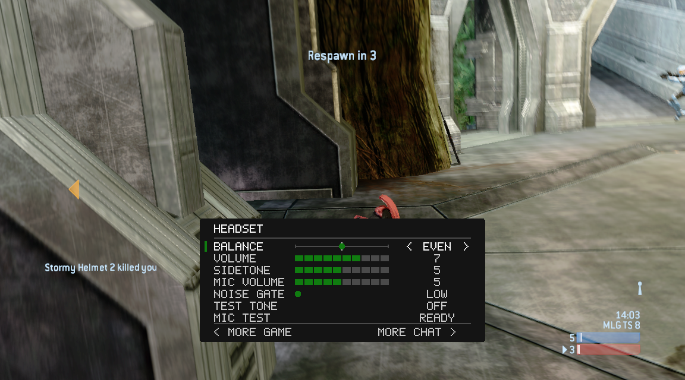

# AmpJack

Plug a wired Xbox One / Series controller into a modded Xbox 360, plug your headset into the controller, and you've replaced your MixAmp. Hold Share and this pops up over whatever you're playing:

**Install:** grab the zip from the [latest release](https://github.com/Roasted-Codes/AmpJack/releases/latest), copy `xw.xex`, `xw.presets` and `xw.demo` to `Hdd:\Plugins\` on the 360, add one line for `xw.xex` to `launch.ini`, and reboot. That's it, no computer needed after that. Or point your agent at this repo and tell it to install it. Details in [`docs/WIRED.md`](docs/WIRED.md).

## What you get

- Wired Xbox One / Series pads (and the SCUF Instinct Pro) working as normal 360 controllers, rumble included.
- Game sound and chat in the headset, with a Game / Chat balance, volume, sidetone and mic volume.
- A noise gate for your mic, and a mic test that records you and plays it back.
- Sound presets (plus a CUSTOM one with bass, mids and treble), and headphone surround for games that play 5.1, with a demo you can play from the panel.
- Mute by tapping Share.

AmpJack was called Xbox360-GIP-Wired while it was being built; the docs still use that name in places.

## Thanks

- [Xbox360-Series-Controllers-Native](https://github.com/Jacckii/Xbox360-Series-Controllers-Native) by Jacckii: the plugin this is a fork of.
- [xone](https://github.com/dlundqvist/xone) by Severin von Wnuck-Lipinski (medusalix) and contributors: the controller protocol code.
- [mt76](https://github.com/openwrt/mt76) by Felix Fietkau, Lorenzo Bianconi and Stanislaw Gruszka: the wireless adapter's radio definitions.
- [hiddriver360](https://github.com/EinTim23/hiddriver360) by EinTim23: the USB transfer API and the XInput route.
- [The ZEFERENCE](https://github.com/XxUnkn0wnxX/TheZEFERENCE) by ZaliaS: the sound presets (all but BASS BOOST).
- The [SADIE II database](https://www.york.ac.uk/sadie-project/database.html), University of York (Apache-2.0): the measurements behind the headphone surround. Details in [`NOTICE`](NOTICE).
- iMoD1998's Detours.h: the PowerPC function hooks.
- [micro-ecc](https://github.com/kmackay/micro-ecc) by Kenneth MacKay: the handshake's cryptography.
- [OpenXeChain](https://github.com/OpenXeChain) and SynthXEX: the toolchain that builds it.
- [BadUpdate](https://github.com/grimdoomer/Xbox360BadUpdate) by grimdoomer: running code on kernel 17559.

Licensed under [GPL-3.0](LICENSE).
